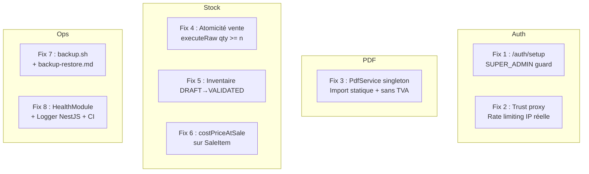

# Design Document

## Overview

La Phase 0 — Audit & Fiabilité est un plan de remédiation ciblant huit vulnérabilités critiques du backend StockTN. Aucune fonctionnalité métier nouvelle n'est introduite. Toutes les corrections respectent les invariants globaux du projet : isolation multi-tenant par `tenantId`, transactions Prisma pour toute opération financière ou stock, journalisation dans `ActivityLog`, montants en `Decimal(10,3)` et DTO validés avec messages en français.

Stack concernée : NestJS 11 / TypeScript strict / Prisma 7 / PostgreSQL 16. Les corrections sont regroupées en huit blocs indépendants qui peuvent être livrés dans l'ordre ou en parallèle, avec une seule migration Prisma couvrant l'ensemble des changements de schéma.

**Pourquoi pas de property-based testing pour cette phase :**
La Phase 0 ne contient aucune logique métier pure (pas de parsers, transformateurs, algorithmes). Toutes les corrections portent sur des opérations I/O (DB, PDF, HTTP, shell), de la configuration (trust proxy, guards) et des artefacts d'infrastructure (scripts, CI). Les tests appropriés sont des tests unitaires ciblés (mocks Prisma), des tests d'intégration et des smoke tests.

---

## Architecture

### Vue d'ensemble des corrections



### Principe de non-régression

Toutes les corrections sont **additive-only** sur l'API publique : aucun champ existant n'est supprimé ni renommé. Les nouveaux champs (`status` sur `InventorySession`, `costPriceAtSale` sur `SaleItem`) sont ajoutés aux réponses sérialisées sans modifier la structure existante.

---

## Components and Interfaces

### Fix 1 — Protection de `/auth/setup`

**Fichier :** `backend/src/auth/auth.service.ts` — méthode `setup()`

**Problème actuel :** La méthode vérifie `user.count() > 0`, ce qui échoue si des utilisateurs ADMIN/EMPLOYEE existent mais aucun SUPER_ADMIN.

**Correction :**

```typescript
// AVANT
const userCount = await this.prisma.user.count();
if (userCount > 0) {
  return this.register(dto);  // appel silencieux en fallback
}

// APRÈS
const superAdminCount = await this.prisma.user.count({
  where: { role: 'SUPER_ADMIN' },
});
if (superAdminCount > 0) {
  throw new ConflictException(
    "L'application est déjà initialisée. Utilisez /auth/login pour vous connecter.",
  );
}
```

La méthode `register()` n'est plus appelée en fallback depuis `setup()`. Le flux est : SUPER_ADMIN existe → 409 immédiat ; aucun SUPER_ADMIN → créer le premier tenant et l'utilisateur ADMIN.

**Interface publique :** Inchangée. `POST /api/auth/setup` retourne 201 ou 409.

---

### Fix 2 — Trust proxy + Rate limiting IP réelle

**Fichiers :** `backend/src/main.ts`, `backend/src/auth/auth.controller.ts`

**Problème actuel :** Express ne sait pas lire l'IP réelle depuis `X-Forwarded-For` derrière Nginx. Le throttler compte toutes les requêtes proxy sous la même IP interne.

**Corrections :**

**`main.ts`** — Ajouter après `NestFactory.create()` :

```typescript
if (configService.get<string>('NODE_ENV') === 'production') {
  app.getHttpAdapter().getInstance().set('trust proxy', 1);
}
```

`trust proxy: 1` indique à Express de faire confiance au premier hop de proxy uniquement, ce qui expose l'IP client réelle via `req.ip` sans permettre à un attaquant d'usurper des niveaux supérieurs.

**`ThrottlerGuard` personnalisé** — Créer `backend/src/common/guards/throttler-proxy.guard.ts` :

```typescript
import { Injectable } from '@nestjs/common';
import { ThrottlerGuard } from '@nestjs/throttler';
import { Request } from 'express';

@Injectable()
export class ThrottlerProxyGuard extends ThrottlerGuard {
  protected async getTracker(req: Request): Promise<string> {
    // req.ip est l'IP réelle si trust proxy est activé
    return req.ip ?? req.socket.remoteAddress ?? 'unknown';
  }

  protected async throwThrottlingException(): Promise<void> {
    // Ajouter l'en-tête Retry-After via la réponse active
    // NestJS ThrottlerGuard >= 5.x expose la réponse dans le contexte
    throw new import('@nestjs/common').HttpException(
      'Trop de tentatives. Veuillez réessayer dans 60 secondes.',
      429,
    );
  }
}
```

**`app.module.ts`** — Remplacer `ThrottlerGuard` par `ThrottlerProxyGuard` dans les providers globaux.

**`auth.controller.ts`** — L'annotation `@Throttle({ default: { limit: 5, ttl: 60000 } })` sur `/login` est déjà en place ; aucun changement requis.

**En-tête `Retry-After` :** Créer un filtre d'exception `ThrottlerExceptionFilter` qui intercepte `ThrottlerException` et ajoute `res.setHeader('Retry-After', '60')` avant de retourner le 429.

---

### Fix 3 — PdfService singleton avec import statique

**Fichier nouveau :** `backend/src/pdf/pdf.service.ts`  
**Module nouveau :** `backend/src/pdf/pdf.module.ts`

**Problème actuel :** `require('pdfmake')` dynamique dans `sales.service.ts` et `purchases.service.ts` crée une nouvelle instance par appel et bloque le module loading.

**Import statique à utiliser :**

```typescript
import PdfPrinter from 'pdfmake/build/pdfmake';
```

> **Note de compatibilité :** `pdfmake` v0.3.x (présent dans `package.json`) expose un export CJS. Avec `"esModuleInterop": true` dans `tsconfig.json` (vérifier) et `"moduleResolution": "node"`, l'import default fonctionne. Si ce n'est pas le cas, utiliser `import * as PdfPrinter from 'pdfmake/build/pdfmake'`.

**Interface du service :**

```typescript
@Injectable()
export class PdfService {
  private readonly logger = new Logger(PdfService.name);
  private readonly printer: PdfPrinter;

  constructor() {
    const fonts = {
      Helvetica: {
        normal: 'Helvetica',
        bold: 'Helvetica-Bold',
        italics: 'Helvetica-Oblique',
        bolditalics: 'Helvetica-BoldOblique',
      },
    };
    this.printer = new PdfPrinter(fonts);
  }

  async generateBuffer(docDefinition: TDocumentDefinitions): Promise<Buffer> {
    try {
      const pdfDoc = this.printer.createPdfKitDocument(docDefinition);
      return await this.toBuffer(pdfDoc);
    } catch (error) {
      this.logger.error('Échec de la génération du PDF', error);
      throw new InternalServerErrorException('Échec de la génération du PDF');
    }
  }

  private toBuffer(doc: PDFKit.PDFDocument): Promise<Buffer> {
    return new Promise((resolve, reject) => {
      const chunks: Buffer[] = [];
      doc.on('data', (chunk) => chunks.push(chunk));
      doc.on('end', () => resolve(Buffer.concat(chunks)));
      doc.on('error', reject);
      doc.end();
    });
  }
}
```

**Suppression TVA :** Les `docDefinition` dans `sales.service.ts::generateInvoicePdf()` et `purchases.service.ts::generateOrderPdf()` ne doivent contenir aucun des termes : TVA, taxe, VAT, Tax, taux de taxe, montant de taxe, ni aucun pourcentage de taxe. Les deux méthodes délèguent la construction du buffer à `PdfService.generateBuffer()`.

**`PdfModule`** est exporté globalement et importé dans `SalesModule` et `PurchasesModule`.

---

### Fix 4 — Atomicité de la décrémentation de stock

**Fichier :** `backend/src/sales/sales.service.ts` — méthode `create()`

**Problème actuel :** Le pattern lecture-vérification-update n'est pas atomique : deux ventes concurrentes peuvent lire le même `qty`, passer la vérification, et toutes deux décrémenter, aboutissant à un stock négatif.

**Correction — pattern `executeRaw` conditionnel :**

```typescript
// Avant la transaction : une seule requête pour name + priceBuy
const product = await this.prisma.product.findFirst({
  where: { id: item.productId, tenantId, isActive: true },
  select: { id: true, name: true, priceBuy: true, qty: true },
});
if (!product) throw new NotFoundException(`Produit ${item.productId} non trouvé`);
if (product.priceBuy === null) {
  throw new BadRequestException(
    `Le coût d'achat du produit "${product.name}" est manquant`,
  );
}
```

À l'intérieur de la transaction, remplacer `tx.product.update({ data: { qty: { decrement } } })` par :

```typescript
const result = await tx.$executeRaw`
  UPDATE products
  SET qty = qty - ${item.qty}
  WHERE id = ${item.productId}
    AND tenant_id = ${tenantId}
    AND qty >= ${item.qty}
`;
if (result === 0) {
  // Lire qty actuel pour message d'erreur précis
  const current = await tx.product.findFirst({
    where: { id: item.productId },
    select: { qty: true, name: true },
  });
  throw new BadRequestException(
    `Stock insuffisant pour "${current?.name}": disponible ${current?.qty ?? 0}, demandé ${item.qty}`,
  );
}
```

La pré-lecture de `product.qty` faite uniquement pour vérification est **supprimée** ; la vérification est désormais dans la clause `WHERE qty >= $qty`. La lecture de `product.name` et `product.priceBuy` (nécessaire pour `costPriceAtSale`) est conservée dans une requête unique **avant** la transaction.

**Garantie :** Deux ventes concurrentes sur le même produit ne peuvent pas toutes deux passer le `WHERE qty >= n` si le stock total est insuffisant — PostgreSQL garantit la sérialisation au niveau row-lock lors de l'UPDATE.

---

### Fix 5 — Workflow Inventaire DRAFT → VALIDATED

**Fichiers :** `backend/prisma/schema.prisma`, `backend/src/inventory/inventory.service.ts`, `backend/src/inventory/inventory.controller.ts`

#### Changements de schéma

```prisma
enum InventoryStatus {
  DRAFT
  VALIDATED
}

model InventorySession {
  // ... champs existants ...
  status    InventoryStatus @default(DRAFT)
  // ...
}
```

#### Méthode `create()` modifiée

La méthode **ne touche plus aux stocks**. Elle crée la session avec `status: DRAFT` et enregistre les `qtySystem` au moment de la création (snapshot du stock actuel) sans appliquer de correction.

```typescript
async create(tenantId, userId, dto) {
  // Lire qtySystem pour chaque produit (snapshot)
  // Calculer difference = qtyPhysical - qtySystem
  // Si difference !== 0 et pas de commentaire → BadRequestException
  
  const session = await this.prisma.inventorySession.create({
    data: {
      tenantId,
      status: 'DRAFT',          // ← Nouveau : toujours DRAFT
      notes: dto.notes ?? null,
      createdBy: userId,
      items: { create: productData },
    },
    include: { items: { include: { product: true } } },
  });
  
  // PAS de mise à jour des stocks ici
  
  await this.activityLogs.log(tenantId, userId, 'INVENTORY', 'inventory_session', session.id, ...);
  return mapSession(session);
}
```

#### Nouvelle méthode `validate()`

```typescript
async validate(tenantId: string, userId: string, id: string) {
  const session = await this.prisma.inventorySession.findFirst({
    where: { id, tenantId },
    include: { items: true },
  });

  if (!session) throw new NotFoundException("Session d'inventaire non trouvée");
  if (session.status === 'VALIDATED') {
    throw new BadRequestException('Cette session a déjà été validée');
  }

  await this.prisma.$transaction(async (tx) => {
    for (const item of session.items) {
      if (item.difference === 0) continue;

      // Vérifier que l'ajustement ne rendra pas qty négatif
      const product = await tx.product.findFirst({
        where: { id: item.productId },
        select: { qty: true, name: true },
      });
      const newQty = (product?.qty ?? 0) + item.difference;
      if (newQty < 0) {
        throw new BadRequestException(
          `L'ajustement pour "${product?.name}" résulterait en un stock négatif (${newQty})`,
        );
      }

      await tx.product.update({
        where: { id: item.productId },
        data: { qty: { increment: item.difference } },
      });
    }

    await tx.inventorySession.update({
      where: { id },
      data: { status: 'VALIDATED' },
    });
  });

  await this.activityLogs.log(
    tenantId, userId, 'INVENTORY_VALIDATE', 'inventory_session', id,
  );

  return this.findOne(tenantId, id);
}
```

#### Guards sur modification de sessions VALIDATED

Dans `update()` et `delete()` (si implémentés), vérifier `session.status !== 'VALIDATED'` avant toute modification.

#### `mapSession()` — ajout du champ `status`

```typescript
function mapSession(session: any) {
  return {
    // ... champs existants ...
    status: session.status,   // ← Ajouté
    items: session.items?.map(...),
  };
}
```

#### Nouveau endpoint

```typescript
// inventory.controller.ts
@Post(':id/validate')
@Roles('ADMIN', 'SUPER_ADMIN')
@ApiOperation({ summary: "Valider une session d'inventaire DRAFT et appliquer les écarts de stock" })
validate(
  @CurrentUser() user: CurrentUserData,
  @Param('id') id: string,
) {
  return this.inventoryService.validate(user.tenantId, user.sub, id);
}
```

---

### Fix 6 — `costPriceAtSale` sur `SaleItem`

**Fichiers :** `backend/prisma/schema.prisma`, `backend/src/sales/sales.service.ts`

#### Changement de schéma

```prisma
model SaleItem {
  id               String  @id @default(uuid())
  saleId           String  @map("sale_id")
  productId        String  @map("product_id")
  qty              Int
  priceSell        Decimal @map("price_sell") @db.Decimal(10, 3)
  costPriceAtSale  Decimal @map("cost_price_at_sale") @db.Decimal(10, 3)  // ← Nouveau
  // ...
}
```

La migration applique `NOT NULL` avec `DEFAULT 0.000` pour le remplissage des lignes historiques existantes uniquement lors de la migration, sans valeur par défaut persistante dans le schéma Prisma (la valeur est toujours fournie explicitement lors d'une création).

#### `create()` modifié

La lecture de `product.priceBuy` est déjà requise pour le Fix 4 (même requête). La valeur est passée dans chaque `SaleItem` :

```typescript
items: {
  create: dto.items.map((item) => ({
    productId: item.productId,
    qty: item.qty,
    priceSell: item.priceSell,
    costPriceAtSale: productMap[item.productId].priceBuy,  // ← Nouveau
  })),
},
```

Si `product.priceBuy` est `null`, la vente est rejetée avant la transaction (voir Fix 4).

#### `mapSale()` modifié

```typescript
items: sale.items?.map((item: any) => ({
  id: item.id,
  productId: item.productId,
  productName: item.product?.name,
  qty: item.qty,
  priceSell: Number(item.priceSell),
  costPriceAtSale: Number(item.costPriceAtSale).toFixed(3),  // ← Ajouté
})),
```

**Non-régression :** Aucun champ existant n'est supprimé. `costPriceAtSale` est un champ additionnel.

---

### Fix 7 — Sauvegardes PostgreSQL

**Nouveaux fichiers :**
- `backend/scripts/backup.sh`
- `backend/docs/backup-restore.md`

#### `backup.sh` — Structure

```bash
#!/usr/bin/env bash
set -euo pipefail

# Paramètres de connexion depuis l'environnement
# Supporte DATABASE_URL ou variables individuelles PGHOST/PGPORT/PGDATABASE/PGUSER/PGPASSWORD

BACKUP_DIR="${BACKUP_DIR:-backend/backups/}"
TIMESTAMP=$(date +%Y-%m-%d_%H%M%S)

# Validation des prérequis
# Vérification que pg_dump est disponible
# Vérification que BACKUP_DIR est accessible en écriture

# Extraction du nom de base depuis DATABASE_URL si fourni
# Construction du nom de fichier : <PGDATABASE>_YYYY-MM-DD_HHMMSS.dump

# Exécution pg_dump --format=custom
# Gestion d'erreur : exit non-zéro + message sur stderr avec date, base et cause

# ─── Cron (commentaire documenté) ──────────────────────────────────────────
# Exécution quotidienne à 02h00 avec rétention 14 jours :
# 0 2 * * * /path/to/backup.sh >> /var/log/stocktn-backup.log 2>&1
# 0 3 * * * find /path/to/backups -name "*.dump" -mtime +14 -delete
```

#### `backup-restore.md` — Structure

- Prérequis : PostgreSQL 16 client (`pg_dump`, `pg_restore`), accès réseau à la base
- Commande de restauration complète : `pg_restore --clean --if-exists -d $DATABASE_URL <fichier.dump>`
- Vérifications post-restauration :
  1. Compte des tables : `SELECT count(*) FROM information_schema.tables WHERE table_schema = 'public'`
  2. Compte des tenants : `SELECT count(*) FROM tenants`
  3. Connexion applicative : `GET /api/health` doit retourner `{ "status": "ok", "db": "ok" }`

#### `.gitignore`

Ajouter la ligne `backend/backups/` dans `.gitignore` à la racine du projet.

---

### Fix 8 — Observabilité

#### HealthModule

**Nouveaux fichiers :**
- `backend/src/health/health.controller.ts`
- `backend/src/health/health.module.ts`

```typescript
// health.controller.ts
@Public()
@SkipSubscription()
@Controller('health')
export class HealthController {
  private readonly logger = new Logger(HealthController.name);

  constructor(private readonly prisma: PrismaService) {}

  @Get()
  async check(): Promise<HealthResponse> {
    const uptime = Math.floor(process.uptime());
    const version = packageJson.version;  // import statique de package.json

    try {
      await Promise.race([
        this.prisma.$queryRaw`SELECT 1`,
        new Promise((_, reject) =>
          setTimeout(() => reject(new Error('timeout')), 2000),
        ),
      ]);
      return { status: 'ok', db: 'ok', uptime, version };
    } catch {
      // Retourner 503 avec corps JSON
      throw new HttpException(
        { status: 'error', db: 'error', uptime, version },
        HttpStatus.SERVICE_UNAVAILABLE,
      );
    }
  }
}
```

**Import de `package.json`** : Ajouter `"resolveJsonModule": true` dans `tsconfig.json` si absent, puis `import packageJson from '../../../package.json'`.

**Réponse 200 :**
```json
{ "status": "ok", "db": "ok", "uptime": 3600, "version": "1.0.0" }
```

**Réponse 503 :**
```json
{ "status": "error", "db": "error", "uptime": 3600, "version": "1.0.0" }
```

La réponse 503 doit être retournée dans un délai total de 3 secondes (timeout DB à 2s + traitement < 1s).

#### Remplacement des `console.log/error`

Tous les fichiers dans `backend/src/` contenant `console.log()` ou `console.error()` sont mis à jour :

| Fichier | Remplacement |
|---|---|
| `auth/auth.service.ts` | `private readonly logger = new Logger(AuthService.name)` |
| `main.ts` | `Logger.log(...)` (logger statique NestJS) |
| Tout autre fichier `src/` | Instance `Logger` nommée par le service |

**Format de log JSON en production :**

NestJS ne produit pas de JSON structuré par défaut. Créer un `JsonLogger` custom (implémentant `LoggerService`) ou utiliser le package `nestjs-pino` (à évaluer selon les dépendances existantes). Si `nestjs-pino` n'est pas souhaitable, un `CustomLogger` minimal suffit :

```typescript
// backend/src/common/logger/json-logger.service.ts
@Injectable()
export class JsonLoggerService implements LoggerService {
  log(message: string, context?: string) {
    if (process.env.NODE_ENV === 'production') {
      console.log(JSON.stringify({ level: 'log', message, context, timestamp: new Date().toISOString() }));
    } else {
      // Format texte pour le développement
    }
  }
  // error(), warn(), debug(), verbose()
}
```

Déclaré dans `main.ts` : `app.useLogger(new JsonLoggerService())`.

#### Pipeline CI

**Fichier :** `.github/workflows/ci.yml`

```yaml
name: CI

on:
  push:
    branches: [main]
  pull_request:
    branches: [main]

jobs:
  build-and-test:
    runs-on: ubuntu-latest
    defaults:
      run:
        working-directory: backend

    steps:
      - uses: actions/checkout@v4

      - name: Setup Node.js
        uses: actions/setup-node@v4
        with:
          node-version: '20'
          cache: 'npm'
          cache-dependency-path: backend/package-lock.json

      - name: Install dependencies
        run: npm ci

      - name: Lint
        run: npm run lint

      - name: Build
        run: npm run build

      - name: Test
        run: npm test -- --passWithNoTests
```

Chaque étape échoue le workflow si elle retourne un code non-zéro ; GitHub Actions n'exécute pas les étapes suivantes par défaut.

---

## Data Models

### Migration Prisma unique — Phase 0

Une seule migration couvre les trois changements de schéma :

```sql
-- Migration: phase0_reliability

-- 1. Enum InventoryStatus
CREATE TYPE "InventoryStatus" AS ENUM ('DRAFT', 'VALIDATED');

-- 2. Champ status sur inventory_sessions
ALTER TABLE "inventory_sessions"
  ADD COLUMN "status" "InventoryStatus" NOT NULL DEFAULT 'DRAFT';

-- 3. Champ cost_price_at_sale sur sale_items
-- NOT NULL avec valeur de remplissage 0.000 pour les lignes historiques
ALTER TABLE "sale_items"
  ADD COLUMN "cost_price_at_sale" DECIMAL(10,3) NOT NULL DEFAULT 0.000;
-- Supprimer le DEFAULT après remplissage (optionnel — Prisma gère via les DTOs)
```

**Schéma Prisma final — diff :**

```prisma
// Nouvel enum
enum InventoryStatus {
  DRAFT
  VALIDATED
}

// InventorySession : ajout du champ status
model InventorySession {
  // ... champs existants ...
  status    InventoryStatus @default(DRAFT)
  // ...
}

// SaleItem : ajout du champ costPriceAtSale
model SaleItem {
  // ... champs existants ...
  costPriceAtSale Decimal @map("cost_price_at_sale") @db.Decimal(10, 3)
}
```

### Synthèse des impacts par entité

| Entité | Changement | Impact API |
|---|---|---|
| `InventorySession` | `+ status: InventoryStatus` | Champ additionnel dans la réponse |
| `SaleItem` | `+ costPriceAtSale: Decimal(10,3)` | Champ additionnel dans la réponse |
| Aucune autre entité | — | — |

---

## Error Handling

### Conventions

Toutes les exceptions sont des exceptions NestJS standard avec messages en français. Aucun `try/catch` inutile autour des opérations Prisma (Prisma lève ses propres exceptions typées).

| Situation | Exception NestJS | Code HTTP |
|---|---|---|
| SUPER_ADMIN existe déjà lors de `/auth/setup` | `ConflictException` | 409 |
| Rate limit dépassé sur `/auth/login` | `ThrottlerException` (+ filtre Retry-After) | 429 |
| Échec génération PDF | `InternalServerErrorException` | 500 |
| Stock insuffisant (atomique) | `BadRequestException` avec produit + qty | 400 |
| `product.priceBuy` manquant | `BadRequestException` | 400 |
| Session inventaire déjà VALIDATED | `BadRequestException` | 400 |
| Ajustement inventaire résulterait en qty < 0 | `BadRequestException` | 400 |
| Session inventaire non trouvée | `NotFoundException` | 404 |
| DB inaccessible sur `/health` | `HttpException` (corps JSON) | 503 |
| Timeout DB sur `/health` (> 2s) | `HttpException` (corps JSON) | 503 |

### Logging

Chaque service dispose d'une instance `Logger` nommée :

```typescript
private readonly logger = new Logger(NomDuService.name);
```

- `logger.error(message, stack)` pour les exceptions inattendues
- `logger.warn(message)` pour les rejets métier (stock insuffisant, etc.)
- `logger.log(message)` pour les événements nominaux (démarrage, initialisation)

En production (`NODE_ENV=production`), le `JsonLoggerService` sérialise chaque entrée comme un objet JSON sur une ligne, incluant `level`, `message`, `context` et `timestamp`.

---

## Testing Strategy

La Phase 0 est une phase de corrections sans logique pure. Les tests appropriés sont :

**Tests unitaires (Jest + mocks Prisma) :**
- `auth.service.spec.ts` : vérifier que `setup()` lance `ConflictException` si `count({ where: { role: 'SUPER_ADMIN' } }) > 0`
- `sales.service.spec.ts` : vérifier que `create()` lance `BadRequestException` si `$executeRaw` retourne 0 ; vérifier que `costPriceAtSale` est correctement transmis
- `inventory.service.spec.ts` : vérifier que `create()` ne modifie pas les stocks ; vérifier que `validate()` lance sur session déjà VALIDATED ; vérifier le rollback si qty < 0
- `pdf.service.spec.ts` : vérifier que le singleton est bien utilisé ; vérifier que la méthode lance `InternalServerErrorException` en cas d'erreur pdfmake
- `health.controller.spec.ts` : vérifier la réponse 200 avec les bons champs ; vérifier la réponse 503 si `$queryRaw` échoue

**Tests d'intégration (optionnels, contre base de test) :**
- Scénario de vente concurrente : deux requêtes simultanées sur le même produit avec stock = 1 → une seule réussit
- Scénario validate inventaire : créer session DRAFT → valider → vérifier stocks mis à jour
- `/api/health` : réponse 200 en conditions normales

**Smoke tests :**
- Pipeline CI : `npm run build` passe sans erreur TypeScript
- `backup.sh` : exécuter avec variables manquantes → exit non-zéro + message stderr
